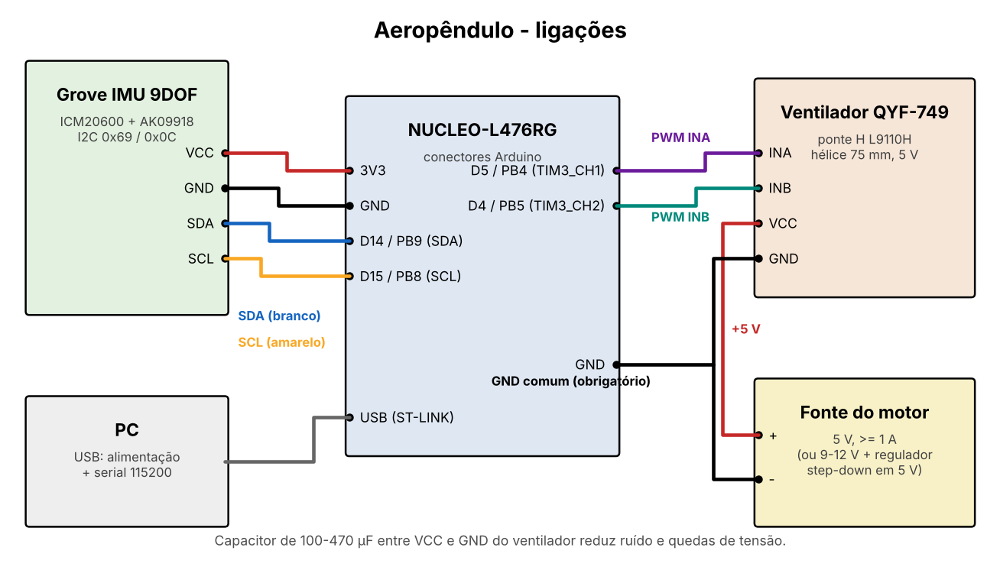

# Aeropêndulo — implementação (NUCLEO-L476RG)

Haste de madeira com duas pontas arredondadas na base (tomba em um só eixo), ventilador QYF-749 (ponte H L9110H) o mais alto possível e Grove IMU 9DOF no topo. Controle PID com integração limitada (*anti-windup*), como no artigo.

```
aeropendulo/
├── firmware/          projeto CMake + HAL (já inclui os drivers da ST)
│   ├── Core/Inc/config.h   ← pinos, eixos da IMU, ganhos padrão
│   └── Core/Src/           main.c, imu.c, motor.c, control.c, serial.c, board.c
├── app/aeropendulo_app.py  monitor no PC (gráfico, comandos, métricas, CSV)
├── docs/ligacoes.png       diagrama de ligações
└── aeropendulo.bin         firmware já compilado (pronto para gravar)
```

---

## 1. Ligações



| Módulo | Pino do módulo | Nucleo (Arduino) | Pino do STM32 |
|---|---|---|---|
| IMU MPU-9250 | VCC | 3V3 | — |
| | GND | GND | — |
| | SDA | D14 | PB9 (I2C1) |
| | SCL | D15 | PB8 (I2C1) |
| Ventilador QYF-749 | INA | D10 | PB6 (TIM4_CH1) |
| | INB | D11 | PA7 (TIM3_CH2) |
| | VCC | **fonte externa +5 V** | — |
| | GND | fonte (−) **e** GND da Nucleo | — |
| PC | — | USB do ST-LINK | USART2 (PA2/PA3) |

### Alimentação do ventilador (9 V ou 12 V?)

O módulo do ventilador é especificado para **5 V** (motor DC pequeno, hélice de 75 mm). Ligar 9 V ou 12 V direto nele sobrecarrega o motor, e 12 V é o limite máximo do L9110H.

**Recomendação, da melhor para a pior:**

1. **Fonte de 12 V + regulador step-down (buck) ajustado em 5 V**, por exemplo um LM2596 ou MP1584, que custam poucos reais. É a solução mais estável, e a fonte de 12 V que você já está avaliando serve para isso.
2. **Carregador USB de 5 V / 1 A ou mais**, com um cabo USB cortado.
3. **Bateria de 9 V direto, só limitando a razão cíclica:** o firmware já limita a razão cíclica a 55 % (`dmax 55`, padrão; 55 % de 9 V ≈ 5 V em média) em todos os modos. Com fonte de 5 V regulada, use `dmax 100`. Uma bateria quadrada tem pouca capacidade e a tensão cai bastante com corrente, então o empuxo vai variar durante o ensaio. Serve só para um teste rápido.

**Não** alimente o motor pelo pino 5V da Nucleo: a corrente de partida do motor derruba o USB e reinicia a placa.

**Cuidados:**
- O **GND comum** entre a fonte, o ventilador e a Nucleo é obrigatório.
- Um capacitor de 100 a 470 µF nos terminais VCC/GND do ventilador ajuda a reduzir ruído.

---

## 2. Compilar e gravar

### Opção rápida: só gravar
Conecte a Nucleo ao PC. Ela aparece como um pen drive chamado **NOD_L476RG**. Arraste o arquivo `aeropendulo.bin` para dentro dele; o LED pisca e a placa reinicia com o firmware novo.

### Compilar (para modificar o código)
1. Instale o **STM32CubeCLT** (site da ST). Ele traz o compilador `arm-none-eabi-gcc`, o CMake, o Ninja e o STM32CubeProgrammer de uma vez.
2. (Opcional) Instale o VS Code com a extensão **STM32Cube for Visual Studio Code**.
3. Em um terminal, dentro de `firmware/`:
   ```
   cmake -B build -G Ninja -DCMAKE_TOOLCHAIN_FILE=cmake/arm-none-eabi.cmake
   cmake --build build
   ```
4. Grave `build/aeropendulo.bin` arrastando para o NOD_L476RG, ou use:
   `STM32_Programmer_CLI -c port=SWD -w build/aeropendulo.elf -v -rst`

> Se preferir o STM32CubeIDE: crie um projeto vazio para a NUCLEO-L476RG **sem** gerar código pelo CubeMX e copie `Core/` para dentro dele. O caminho pelo CMake é mais simples.

### App do PC
```
pip install pyserial matplotlib
python app/aeropendulo_app.py          # detecta a Nucleo sozinho
python app/aeropendulo_app.py --demo   # haste simulada, para testar sem hardware
```
O app mostra as mensagens da placa no terminal e envia comandos pela caixa `cmd`. Também dá para usar qualquer terminal serial (115200 8N1) e digitar `help`.

---

## 3. Etapa 1 — teste individual dos módulos

Anote os resultados: eles vão para o relatório.

### 3.1 Comunicação e IMU
1. Ligue só a IMU e o USB. Ao iniciar, a placa deve imprimir `IMU ICM-20600 found at 0x69`.
2. Digite `scan`: devem aparecer **0x69** (acelerômetro/giroscópio) e **0x0C** (magnetômetro).
   - Se nada aparecer, verifique SDA/SCL trocados, alimentação e GND.
3. Com a haste parada, digite `cal` para calibrar o giroscópio.
4. Digite `imu`. O app passa a mostrar três curvas: θ do acelerômetro, θ do giroscópio integrado e θ filtrado.

**Ajuste dos eixos** (depende de como a IMU foi presa na haste):
- **Eixo UP:** com a haste vertical, o eixo do acelerômetro (colunas `ax ay az`) que marca ≈ **+1 g**. Se marcar −1 g, use o sinal `-`.
- **Eixo SIDE:** incline a haste para o lado em que o ventilador empurra; é o eixo do acelerômetro que muda.
- **Eixo GYRO:** o eixo do giroscópio que reage ao inclinar.
- Aplique com, por exemplo, `axes +x +y +z` (na ordem up, side, gyro).
- Escolha os sinais para que **θ aumente** ao inclinar para o lado do empurrão do ventilador e para que θ giroscópio acompanhe θ acelerômetro.

**Critérios de coerência:**
- Parado e vertical: θ ≈ 90° e |a| ≈ 1 g.
- Incline a haste em ângulos conhecidos (transferidor ou inclinômetro do celular): θ do acelerômetro deve bater com erro de ~1°.
- Balance a haste: θ do giroscópio deve seguir θ do acelerômetro, com deriva menor que ~1°/10 s após o `cal`.
- O θ filtrado deve ser suave e sem atraso perceptível.

### 3.2 Ventilador
1. Ligue a fonte do motor, com o GND comum.
2. `motor 30` gira para um lado e `motor -30` para o outro. `stop` desliga.
3. **Zona morta:** use `ramp`, que vai de 10 % a 100 % nos dois sentidos, 1,5 s por passo. Anote a menor razão cíclica em que a hélice gira e configure com `dz <valor>` (ex.: `dz 18`).
4. **Curva de empuxo:** coloque o módulo do ventilador sobre uma balança de cozinha com o fluxo de ar **para cima**. O empuxo empurra o módulo para baixo, então a leitura aumenta. Rode `ramp` e anote a leitura (em gramas-força) para cada razão cíclica, nos dois sentidos. Isso mede o empuxo máximo e a assimetria do sentido reverso, que entram no modelo.
5. **Sinal do motor:** com a haste em pé, segurando-a de leve pela base, rode `motor 40`. O empurrão deve fazer **θ aumentar**. Se diminuir, digite `msign -1`.

---

## 4. Etapa 2/3 — controle em malha fechada

1. `status` para conferir eixos, ganhos e limites.
2. Segure a haste perto de 90° e clique em **Run** (ou digite `run`). Use **Stop** a qualquer momento. A placa também desliga o motor sozinha se |θ − 90°| passar de 30°.
3. **Ajuste dos ganhos**, sempre um por vez, com `pid KP KI KD`:
   - **Comece com `pid 0.10 0 0.008`.** Aumente KP até a haste se sustentar e oscilar pouco. Depois aumente KD até a oscilação amortecer.
   - **Acrescente KI** (0,1 a 0,5) para zerar o erro de regime.
   - **Limites da integração limitada** (`ilim MIN MAX`): devem conter o comando que segura a haste em regime. Veja o valor de `I` no app com a haste parada em 80° e em 100° e use cerca de 1,25 vez esses valores.
4. **Ensaios para o relatório:**
   - Degrau de referência (botões Ref ±10°).
   - Toque na haste: clique em **Toque** e empurre a haste.
   - Comparação com e sem *anti-windup* (`ilim -1 1` em vez dos limites ajustados).
   - O app mostra o desvio máximo e o tempo de acomodação (±2°) e salva tudo em CSV.

---

## 5. Comandos do firmware

| Comando | Função |
|---|---|
| `help`, `status` | ajuda, configuração atual |
| `scan` | varredura do barramento I2C |
| `imu` | transmite acelerômetro/giroscópio/ângulos (linhas `I,...`) |
| `cal` | calibra o giroscópio (haste parada) |
| `axes U S G` | eixos da IMU, ex. `axes +x -y +z` |
| `motor P` | razão cíclica P % em malha aberta (−100…100) |
| `ramp` | rampa de 10 a 100 % nos dois sentidos |
| `dz P`, `msign ±1` | zona morta do motor, sinal do motor |
| `dmax P` | teto da razão cíclica em todos os modos (padrão 55 %) |
| `run`, `stop` | liga o controle, desliga tudo |
| `ref D` | referência em graus (70…110, 90 = vertical) |
| `pid KP KI KD` | ganhos (u por grau, por grau·s, por grau/s) |
| `ilim MIN MAX` | limites do integrador (integração limitada) |
| `ulim MIN MAX` | limites do atuador |

Telemetria (50 Hz): `D,t_ms,theta,ref,u,I,duty,theta_acc,rate`.

**Observação:** as configurações feitas por comando valem até a placa reiniciar. Depois de achar os valores, copie-os para `Core/Inc/config.h` e recompile.
